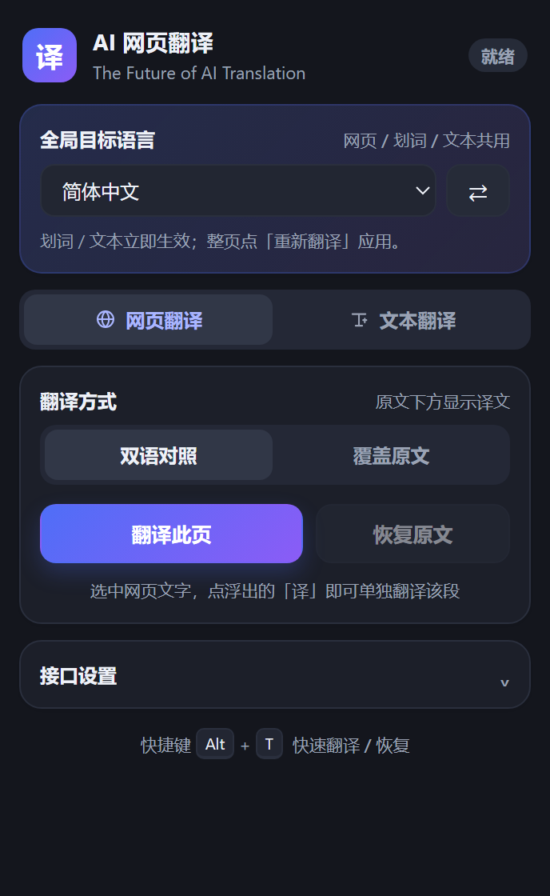
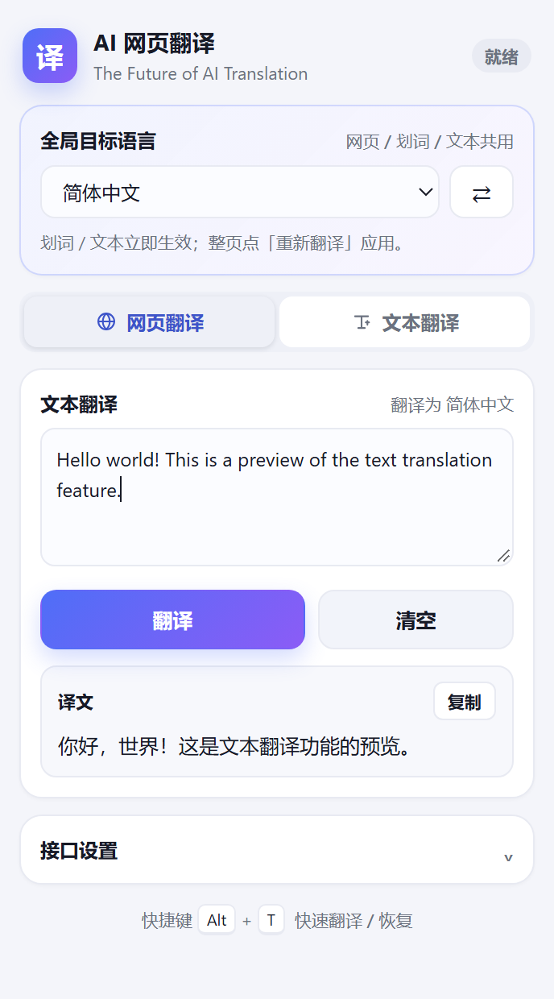

# AI 网页翻译

一个简洁的 Chrome 翻译扩展：接入 AI 接口，支持整页翻译、划词翻译和弹窗内文本翻译，三种功能共用一个全局目标语言。

## 功能

- **整页翻译**：自动提取网页正文文本，分批发送给 AI。
- **边译边显示**：流式接收结果，AI 每返回一句就立即插入页面，不用等整页翻译完；不支持流式的接口会自动降级为普通模式。
- **视口优先**：优先翻译你当前正在看的内容，滚动后下一批会跟着当前视口走，不再从页面顶部或底部机械地铺开。
- **划词翻译**：选中网页文字后，旁边会出现「译」按钮，点一下即可单独翻译这段话；双语模式弹出译文卡片并保留原文，覆盖模式直接替换选区（可撤销）。
- **文本翻译**：在扩展弹窗里直接输入文字翻译（汉译英、英译汉等），结果可复制，不依赖当前网页。
- **两种模式**
  - 双语对照：原文下方显示译文，阅读原文和译文都方便。
  - 覆盖原文：直接用译文替换页面文字。
  - 翻译后可随时切换模式，使用本地缓存即时重排，不会重复消耗接口额度。
- **全局目标语言**：顶部一个下拉框控制网页、划词、文本三种翻译，支持简体中文、繁體中文、English、Français、Deutsch、Español、Русский、日本語、한국어、Português、Italiano、العربية 等 20 多种语言。
- **接口可配置**：支持 OpenAI、DeepSeek、Anthropic Claude，以及任意 OpenAI 兼容接口（Kimi、Qwen、Ollama、LM Studio、One API 等）。
- **思考强度可调**：默认「关闭」，翻译不消耗推理 token；也可按需选择低 / 中 / 高。
- **恢复原文**：一键还原页面，不改动网页本身。
- **快捷键**：`Alt + T` 翻译 / 恢复当前页面（可在 `chrome://extensions/shortcuts` 修改）。
- **本地存储**：API Key 只保存在浏览器本地，不经过任何中转服务器。

## 界面预览

<p align="center">
  
  
</p>

## 安装

1. 打开 Chrome，地址栏输入 `chrome://extensions/`。
2. 打开右上角「开发者模式」。
3. 点击「加载已解压的扩展程序」，选择本文件夹（`翻译插件`）。
4. 建议把扩展固定到工具栏，方便使用。

> 安装后已打开的旧标签页需要刷新一下，扩展才能注入翻译脚本。新打开的页面不受影响。
> Edge 等其他 Chromium 内核浏览器也可以在 `edge://extensions/` 中「加载解压缩的扩展」使用。

## 配置

点击扩展图标 → 展开「接口设置」：

| 服务商 | API 地址 | 模型示例 |
| --- | --- | --- |
| OpenAI | `https://api.openai.com/v1` | `gpt-4o-mini`、`gpt-5.1` |
| DeepSeek | `https://api.deepseek.com/v1` | `deepseek-flash` |
| Anthropic | `https://api.anthropic.com` | `claude-haiku-5-5`、`claude-sonnet-5-5` |
| Ollama（本地） | `http://localhost:11434/v1` | `qwen2.5:7b`（Key 可留空） |
| 任意兼容接口 | 例如 `https://api.moonshot.cn/v1` | 对应模型名 |

填写 API Key 后点「测试连接」，看到「连接成功」即可使用。

选择服务商时会自动填入对应的地址和模型，也可以手动改成自己的中转地址。

> DeepSeek 旧的 `deepseek-chat` / `deepseek-reasoner` 已下线，请使用 `deepseek-flash`（V4.1 Flash）。

### 思考强度

翻译属于简单的文本转换任务，不需要长链推理。默认选「关闭」，速度更快、延迟更低、也不会为思考 token 付费。

不同服务商的参数会自动转换：

| 服务商 | 关闭 | 低 / 中 / 高 |
| --- | --- | --- |
| DeepSeek | `thinking: {type: "disabled"}` | `thinking: {type: "enabled"}` + `reasoning_effort` |
| OpenAI 兼容 | 推理模型发送 `reasoning_effort: "none"`；普通模型不发送 | `reasoning_effort: low / medium / high` |
| Anthropic | `thinking: {type: "disabled"}` | `thinking: {type: "adaptive"}` + `output_config.effort` |

- 只有确认是推理模型（如 `o3`、`gpt-5`、`deepseek`、`qwen3` 等）时，关闭思考才会附加参数，避免普通模型报「不支持该参数」。
- 如果模型确实不认这些参数，扩展会自动去掉思考参数重试一次，并记住该模型，后续不再重复尝试。
- DeepSeek V4 默认开启思考，所以用 DeepSeek 时「关闭」尤其重要。

## 使用

打开扩展弹窗后，先在顶部选择**全局目标语言**。网页翻译、划词翻译和文本翻译都会使用这个语言；右侧的 ⇄ 可以在简体中文和 English 之间快速切换。

### 网页翻译

1. 打开任意网页（`http://` / `https://`，本地 `file://` 需在扩展详情里允许访问文件网址）。
2. 点击扩展图标，切到「网页翻译」标签。
3. 选择「双语对照」或「覆盖原文」。
4. 点「翻译此页」，页面右下角会显示进度，可随时停止。
5. 想还原页面时点「恢复原文」。

已翻译状态下切换模式会立刻用缓存重排，不会再次请求接口。修改全局目标语言后，划词和文本翻译立即生效；整页翻译点「重新翻译」用新语言重新请求。

### 文本翻译

1. 切到「文本翻译」标签。
2. 在输入框输入要翻译的文字（最多 5000 字符）。
3. 点「翻译」或按 `Ctrl + Enter`，译文显示在下方，可一键复制。
4. 例如目标语言选 `English` 输入中文就是汉译英；目标选简体中文输入英文就是英译汉。

文本翻译不依赖当前网页，即使所在页面不支持整页翻译（如浏览器设置页、扩展商店）也可以使用。

### 划词翻译

1. 用鼠标或键盘选中网页上的一段文字（最多 5000 字符）。
2. 选区旁边会出现一个「译」按钮，点击它。
3. 当前是「双语对照」：原文保留，选区下方弹出译文卡片，可以继续点原文或滚动页面。
4. 当前是「覆盖原文」：选区直接被译文替换，卡片里提供「撤销替换」，点一下即可恢复原文。

划词翻译使用和整页翻译相同的目标语言、接口和思考强度设置；相同文字会命中本地缓存，不重复请求。
卡片不会拦截页面点击，按 `Esc` 或点卡片外可关闭。

## 工作原理

```
popup（设置 / 触发）
   │  chrome.runtime.sendMessage
   ▼
background.js（读取配置、调用 AI 接口、失败重试、拆批）
   ▲  chrome.runtime.sendMessage
   │
content/content.js（提取文本、分批、渲染译文、缓存、恢复原文）
```

- 文本节点按可见性、标签类型过滤，跳过 `script/style/code/pre`、输入框、代码块、`translate="no"` 等区域。
- 相同文本会去重，同一段文字只翻译一次；按约 900 字符 / 10 段拆批。
- **按视口优先**：先翻译当前屏幕内的内容（从上到下），再翻译下方最近的内容，最后是上方内容；每批开始前都会重新判断视口，滚动页面后下一批会跟着切换。
- 默认使用 SSE 流式输出，解析出完整的一条译文就立刻渲染；服务端不支持时会自动改用普通响应。
- AI 返回格式异常时会自动二分重试，单个片段失败不会阻塞整页。
- 文本翻译复用同一套接口配置，直接通过 background 请求，不依赖页面脚本，因此任何页面都能用。
- 划词翻译在页面顶层注入 Shadow DOM 浮层，点击「译」时读取当前保存的模式和目标语言，复用同一个翻译接口；覆盖模式会保留被替换的节点，支持一键撤销。
- 译文样式由 `content/content.css` 控制；右下角进度条使用 Shadow DOM，避免被网页样式干扰。

## 目录结构

```
manifest.json         扩展清单（MV3）
background.js         后台：配置、API 调用、消息路由
content/content.js    页面脚本：提取、翻译、渲染、恢复
content/content.css   译文样式
popup/popup.html      弹窗界面
popup/popup.css       弹窗样式
popup/popup.js        弹窗逻辑
icons/                扩展图标
```

## 注意事项

- 翻译会把页面文本发送到你配置的 AI 接口，请勿在敏感页面使用不可信的接口。
- 少数网站使用 Canvas / 自定义渲染或强 CSP，可能无法翻译或样式略有偏差。
- 部分按钮、代码块、输入框会有意跳过，避免破坏页面交互。
- 如果提示「无法在此页面运行」，通常是浏览器内置页（如 `chrome://`）、扩展商店或 PDF 阅读器，属于正常限制。
- 如果 `Alt + T` 没有反应，可能是被其他软件占用，可在 `chrome://extensions/shortcuts` 或 `edge://extensions/shortcuts` 重新设置。
- 划词翻译最多处理 5000 字符的选区；Canvas、图片或视频里的文字无法被选中，因此不支持。
- 扩展本身不收集、不上传任何数据；除配置的接口外没有外部请求。
